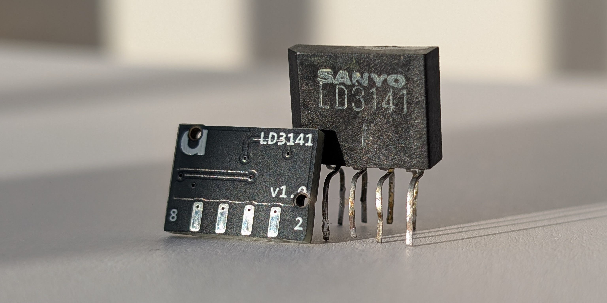
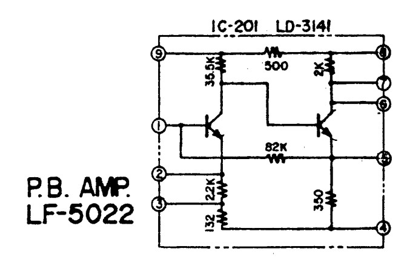

# LD3141 Replacement Board

## What it is?

A drop-in replacement for the legacy LD3141 amplifier module used in AKAI reel-to-reel tape decks from the 70s. Tested in the AKAI 4000DS, should work in many more (4000DB, GX-220, GX-280D and others). Open hardware.

### Compatibility

- I personally tested it in the real AKAI 4000DS with absolutely no issues.
- It should work in any deck that uses the LD3141 (untested though, let me know if you tested it so I can update the list). I've checked a number of manuals and can confirm the following decks explicitly list this module, so the board should work as a drop-in replacement:
  - 4000DB
  - 1730D-SS
  - 1731W
  - CR-80D-SS
  - GX-220
  - GX-225D
  - GX-280D
  - M-11

### Circuit

There's a bit of a mystery around this circuit, and [Wilkinson's Hi-Fi](https://www.wilkinsons.tv/akai-1730d-ss-4channel-deck-the-ld3141-version-20/) has already done a great job covering it, so I won't repeat it here. The schematic I used (and it looks like Wilkinson's Hi-Fi did, too) is the one that seems to be reversed engineered by [Kevin Counihan](https://manuals.sterremuur.nl/Scanned%20documents/IC/LD3141RE2.pdf) in 2003. It also appears to be based on the drawing in the AKAI 1730D-SS service manual:

### Parts

The values follow the original schematic as closely as I could get them from the manual. I also added pads for an optional C1 across Q2's base and collector. It rolls off the high frequencies a little and is only there in case the stage rings on your bench. I ended up not using it.

> [!NOTE]
> Use proper thin-film resistors wherever you can, so you won't be disappointed with the noise floor.

| Ref | Value | Notes |
| --- | --- | --- |
| R1 | 499 Ω | 0.1% thin film |
| R2 | 36 kΩ | 0.1% thin film |
| R3 | 2 kΩ | 0.2 W 0603 - deliberately thick film (0.2 W rating), as otherwise it could get quite hot |
| R4 | 82 kΩ | 0.1% thin film |
| R5 | 130 Ω | 0.1% thin film |
| R6 | 2.2 kΩ | 0.1% thin film |
| R7 | 360 Ω | 0.1% thin film |
| Q1, Q2 | BC847C | Use the ones from the same batch for consistency |
| C1 | not fitted | Optional 4.7–10 pF C0G Miller cap, only if you see ringing on the bench |

LCSC part numbers are in `production/BOM_JLCPCB.csv`.

## About

Built by [@ssam.effects](https://instagram.com/ssam.effects). More pedals and builds over there.
